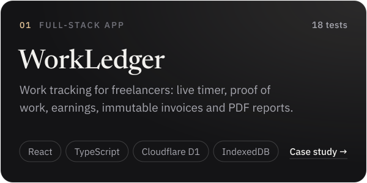
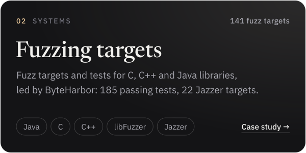
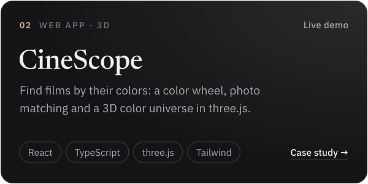
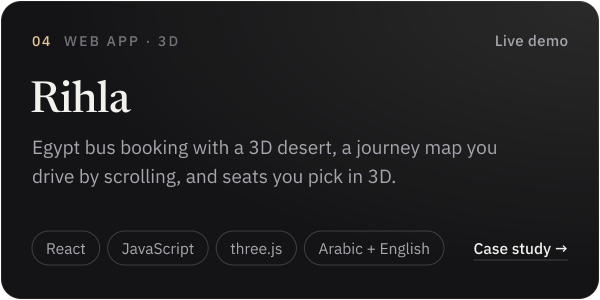
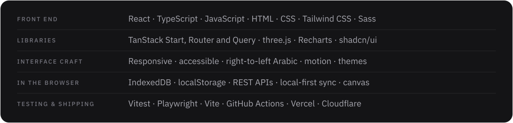

<a href="https://ramezgamel01.github.io">
  <picture>
    <source media="(prefers-color-scheme: dark)" srcset="assets/banner-dark.svg">
    <source media="(prefers-color-scheme: light)" srcset="assets/banner-light.svg">
    
  </picture>
</a>

  <a href="https://ramezgamel01.github.io"><b>Portfolio</b></a> &nbsp;·&nbsp;
  <a href="https://ramezgamel01.github.io/assets/cv/Ramez-Gamel-CV-EN.pdf">CV</a> &nbsp;·&nbsp;
  <a href="https://www.linkedin.com/in/ramez-gamel-002755238">LinkedIn</a> &nbsp;·&nbsp;
  <a href="mailto:ramgamel06@gmail.com">ramgamel06@gmail.com</a>

I'm Ramez, a machine learning and software engineer in Egypt. I build PyTorch pipelines, Python services and React apps, and I've trained and evaluated AI models in Arabic and English since 2022.

أنا رامز، مهندس تعلّم آلي وبرمجيات من مصر.

### Selected work

<a href="https://ramezgamel01.github.io/case-workledger.html"><picture><source media="(prefers-color-scheme: dark)" srcset="assets/card-workledger-dark.svg"><source media="(prefers-color-scheme: light)" srcset="assets/card-workledger-light.svg"></picture></a>
<a href="https://ramezgamel01.github.io/case-fuzzing.html"><picture><source media="(prefers-color-scheme: dark)" srcset="assets/card-fuzzing-dark.svg"><source media="(prefers-color-scheme: light)" srcset="assets/card-fuzzing-light.svg"></picture></a>
<a href="https://cinescope-gamma-ruby.vercel.app"><picture><source media="(prefers-color-scheme: dark)" srcset="assets/card-cinescope-dark.svg"><source media="(prefers-color-scheme: light)" srcset="assets/card-cinescope-light.svg"></picture></a>
<a href="https://ramezgamel01.github.io/rihla-egypt-travel/"><picture><source media="(prefers-color-scheme: dark)" srcset="assets/card-rihla-dark.svg"><source media="(prefers-color-scheme: light)" srcset="assets/card-rihla-light.svg"></picture></a>

Live demo: [WorkLedger](https://ramezgamel01.github.io/workledger/) · Code: [WorkLedger](https://github.com/ramezGamel01/workledger) · [CineScope](https://github.com/ramezGamel01/CINESCOPE) · [Rihla](https://github.com/ramezGamel01/rihla-egypt-travel) · [TaskFlow](https://github.com/ramezGamel01/Task-Flow). The fuzzing repos are private; the case study walks through them.

### Toolbox

<picture>
  <source media="(prefers-color-scheme: dark)" srcset="assets/toolbox-dark.svg">
  <source media="(prefers-color-scheme: light)" srcset="assets/toolbox-light.svg">
  
</picture>

### Now

- Freelance Python software engineer, since December 2023
- Advanced AI data trainer at Data Annotation, since May 2023, writing and reviewing model answers in Arabic and English
- Open to freelance and full-time roles in machine learning, software and front end
