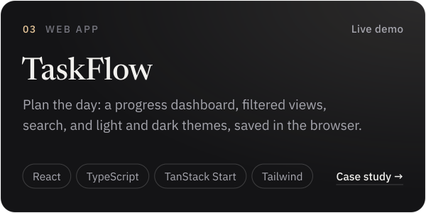

<a href="https://ramezgamel.vercel.app">
  <picture>
    <source media="(prefers-color-scheme: dark)" srcset="assets/banner-dark.svg">
    <source media="(prefers-color-scheme: light)" srcset="assets/banner-light.svg">
    
  </picture>
</a>

  <a href="https://ramezgamel.vercel.app"><b>Portfolio</b></a> &nbsp;·&nbsp;
  <a href="https://ramezgamel.vercel.app/assets/cv/Ramez-Gamel-CV-EN.pdf">CV</a> &nbsp;·&nbsp;
  <a href="https://www.linkedin.com/in/ramez-gamel-002755238">LinkedIn</a> &nbsp;·&nbsp;
  <a href="mailto:ramgamel06@gmail.com">ramgamel06@gmail.com</a>

I'm Ramez, a front-end developer in Egypt. I build fast, accessible interfaces in React and TypeScript, from the first layout to a live site, in English and Arabic.

أنا رامز، مطوّر واجهات أمامية من مصر.

### Selected work

<a href="https://ramezgamel.vercel.app/case-workledger.html"><picture><source media="(prefers-color-scheme: dark)" srcset="assets/card-workledger-dark.svg"><source media="(prefers-color-scheme: light)" srcset="assets/card-workledger-light.svg"></picture></a>
<a href="https://ramezgamel.vercel.app/case-cinescope.html"><picture><source media="(prefers-color-scheme: dark)" srcset="assets/card-cinescope-dark.svg"><source media="(prefers-color-scheme: light)" srcset="assets/card-cinescope-light.svg"></picture></a>
<a href="https://ramezgamel.vercel.app/case-taskflow.html"><picture><source media="(prefers-color-scheme: dark)" srcset="assets/card-taskflow-dark.svg"><source media="(prefers-color-scheme: light)" srcset="assets/card-taskflow-light.svg"></picture></a>
<a href="https://ramezgamel.vercel.app/case-rihla.html"><picture><source media="(prefers-color-scheme: dark)" srcset="assets/card-rihla-dark.svg"><source media="(prefers-color-scheme: light)" srcset="assets/card-rihla-light.svg"></picture></a>

Every card opens a case study. Live: [WorkLedger demo](https://ramezgamel01.github.io/workledger/) · [CineScope](https://cinescope-gamma-ruby.vercel.app) · [TaskFlow](https://task-flow-alpha-navy.vercel.app) · [Rihla](https://ramezgamel01.github.io/rihla-egypt-travel/). Code: [WorkLedger](https://github.com/ramezGamel01/workledger) · [CineScope](https://github.com/ramezGamel01/CINESCOPE) · [TaskFlow](https://github.com/ramezGamel01/Task-Flow) · [Rihla](https://github.com/ramezGamel01/rihla-egypt-travel).

### Toolbox

<picture>
  <source media="(prefers-color-scheme: dark)" srcset="assets/toolbox-dark.svg">
  <source media="(prefers-color-scheme: light)" srcset="assets/toolbox-light.svg">
  
</picture>

### Now

- Freelance front-end developer, building React apps and responsive sites since 2023
- Open to freelance projects and full-time front-end roles
